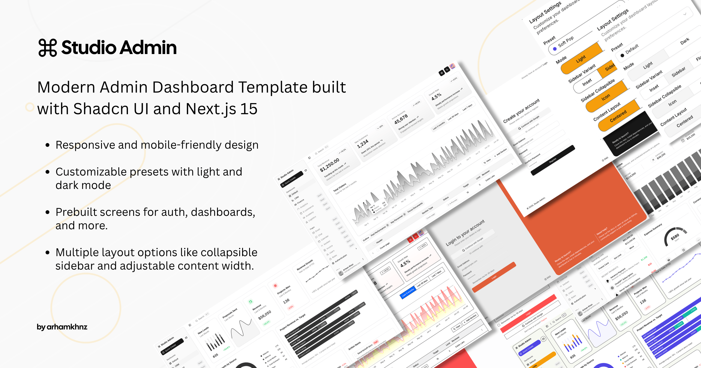

# Studio Admin — Template Admin com TypeScript e shadcn/ui

Dashboard administrativo responsivo com múltiplos dashboards, layouts de autenticação, presets de tema customizáveis e mais.



## Stack técnica

- **Framework**: Next.js 16 (App Router), TypeScript, Tailwind CSS v4
- **Componentes de UI**: Shadcn UI
- **Validação**: Zod
- **Formulários e gerenciamento de estado**: React Hook Form, Zustand
- **Tabelas e manipulação de dados**: TanStack Table
- **Tooling e DX**: Biome, Husky

## Telas

### Disponíveis
- Dashboard Início
- Dashboard CRM
- Dashboard Finanças
- Dashboard Análises
- Dashboard Produtividade
- Dashboard E-commerce
- Dashboard Academia
- Dashboard Logística
- Dashboard Infraestrutura
- Gerenciador de arquivos
- Monitoramento de pacientes
- Página de Chat
- Página de E-mail
- Perfil
- Gestão de usuários
- Gestão de funções
- Quadro Kanban
- Página de tarefas
- Página de faturas
- Página de calendário
- Autenticação (4 telas)
- Legado: Início v1, CRM v1, Finanças v1, Análises v1

> **Nota:** interface traduzida para português do Brasil (veja o progresso nas [issues](https://github.com/prof-ramos/shadcn-admin-sqlite/issues)).

## Arquitetura colocation-based

O projeto segue uma **arquitetura colocation-based**: cada feature mantém as próprias páginas, componentes e lógica dentro da pasta da rota.
A UI compartilhada, hooks e configuração ficam no nível superior, mantendo a base de código modular, escalável e fácil de manter conforme a aplicação cresce.

## Primeiros passos

Você pode rodar o projeto localmente ou fazer o deploy instantâneo com a Vercel.

### Deploy com Vercel

[](https://vercel.com/new/clone?repository-url=https%3A%2F%2Fgithub.com%2Fprof-ramos%2Fshadcn-admin-sqlite)

_Faça o deploy de sua própria cópia com um clique._

### Rodar localmente

1. **Clonar o repositório**
   ```bash
   git clone https://github.com/prof-ramos/shadcn-admin-sqlite.git
   ```

2. **Entrar no projeto**
   ```bash
   cd shadcn-admin-sqlite
   ```

3. **Instalar as dependências**
   ```bash
   npm install
   ```

4. **Iniciar o servidor de desenvolvimento**
   ```bash
   npm run dev
   ```

A aplicação estará disponível em [http://localhost:3000](http://localhost:3000).

### Formatação e lint

Formate, faça lint e organize imports:

```bash
npx @biomejs/biome check --write
```

> Consulte a [documentação do Biome](https://biomejs.dev/) para regras, correções e opções da CLI.

---

> [!IMPORTANT]
> Este projeto é atualizado com frequência. Se você trabalha a partir de um fork ou clone antigo, puxe as últimas alterações antes de sincronizar — algumas atualizações podem conter quebras de compatibilidade.

---

Contribuições são bem-vindas: abra [issues](https://github.com/prof-ramos/shadcn-admin-sqlite/issues), sugira features ou inicie uma discussão.

## Licença e créditos

Distribuído sob a licença [MIT](LICENSE).

Este projeto é uma adaptação localizada do template [next-shadcn-admin-dashboard](https://github.com/arhamkhnz/next-shadcn-admin-dashboard) de [arhamkhnz](https://github.com/arhamkhnz), também sob MIT. As versões Base UI, React Aria e TanStack Start do template original continuam disponíveis no repositório do autor.
